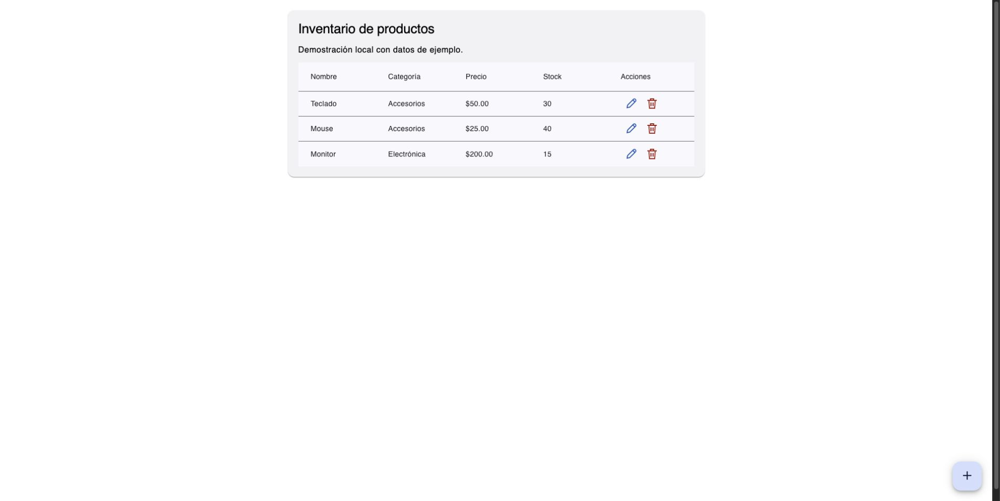

# Inventory frontend

[Daniel Duran](https://www.dan1el64.com/) · Angular 18 · TypeScript · Angular Material · Jasmine/Karma

A product-inventory interface backed by the [Spring Boot API](https://github.com/dan1el64/Inventario_backend). Includes reactive forms, create/edit/delete, accessible action names, a scrollable table on narrow screens, loading/error/retry states and preservation of input after a failed save.



## Run the complete demo

The backend repository provides a single-command launcher for PostgreSQL, API and this interface:

```sh
git clone https://github.com/dan1el64/Inventario_backend.git inventory-backend
cd inventory-backend
./scripts/demo.sh
```

Docker with Compose, Git and OpenSSL are required. It clones this public frontend to `../inventory-frontend` if absent and generates a local-only database password. Open http://localhost:4200. No cloud account or real credentials are required.

## Frontend development

Use Node.js 22 with npm. The lockfile determines dependency versions.

```sh
git clone https://github.com/dan1el64/Inventario_frontend.git inventory-frontend
cd inventory-frontend
npm ci --ignore-scripts
npm start
```

Run the backend at localhost:8080. `proxy.conf.json` forwards `/api` to that address. The API path is `src/app/enviroment/environment.ts` (the existing folder name is preserved). In Docker, Nginx forwards `/api` to service `app`; Angular is served from `dist/inventory-app/browser`. This is a client-rendered demo, not an SSR deployment.

## Build and tests

```sh
npm run build
npm run test:ci
```

Chrome/Chromium is required for Jasmine/Karma; set `CHROME_BIN` if it is not detected automatically. There is no Jest dependency. The suite currently has 12 tests, including HTTP response envelopes, required form fields, fractional-stock rejection, retry after load failure and prevention of duplicate submissions while saving. [GitHub Actions](https://github.com/dan1el64/Inventario_frontend/actions) runs tests, the production build and a container build.

The UI uses the API response envelope `{success, message, data}`. Input rules: name and category required, positive price, integer nonnegative stock. Server-side validation remains authoritative.

## Structure

- `src/app/components/list`: product table, loading, error and retry states.
- `src/app/components/form`: reactive create/edit form.
- `src/app/services`: HTTP adapter and request-contract tests.
- `proxy.conf.json`: local API forwarding.
- `nginx.conf`: container API forwarding and SPA fallback.

This is an independent local portfolio demonstration. It has no authentication, authorization or production deployment. All screenshots use synthetic seeded products. Angular 18 is retained for this bounded repair; a framework upgrade is a separate maintenance task.
